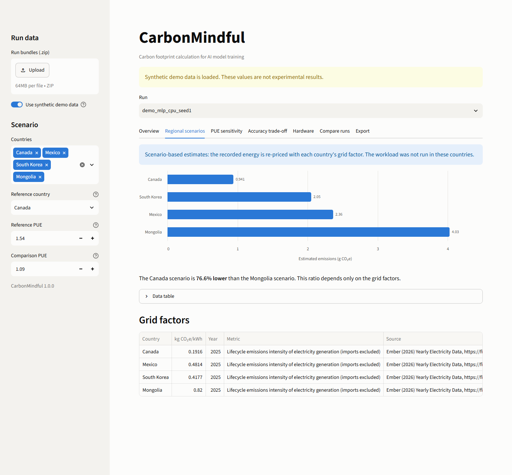

# CarbonMindful

**Carbon footprint calculation for AI model training.** A Streamlit dashboard that turns the energy
recorded for a training run into transparent, reproducible carbon estimates under different grid and
data-centre scenarios.

[](https://github.com/dojedaro/carbonmindful/actions/workflows/ci.yml)

📄 **Paper (accepted):** *CarbonMindful: A Platform for Carbon Footprint Calculation in AI Model Training*,
International Journal of Environment and Waste Management (Inderscience), manuscript IJEWM-315260.
The accepted manuscript is in [`CarbonMindful.pdf`](CarbonMindful.pdf).

🔗 **Live app:** https://daniel-wb95w8tmtafmeaoweszdee.streamlit.app/



Regional values are **scenario-based estimates**: the recorded energy is re-priced with each country's
grid factor. The workload is not run in those countries.

## The calculation

```
E_IT (kWh)  ->  E_facility = E_IT x PUE  ->  CO2e = E_facility x grid factor
```

PUE is applied once, in `carbonmindful/calc.py`. If a bundle records a tracker PUE above 1.0, its
energy is divided by that value first, so PUE is never counted twice. Record with PUE 1.0 where
possible, because this division assumes the tracker's energy already includes its PUE.

## What the dashboard shows

| Tab | What it answers |
|---|---|
| Overview | Energy, emissions and the worked calculation for one run |
| Regional scenarios | The same energy under Canada, Mexico, South Korea and Mongolia grid factors |
| PUE sensitivity | How data-centre efficiency changes the footprint |
| Accuracy trade-off | Validation accuracy against measured per-epoch energy |
| Hardware | CPU / GPU utilisation over the run |
| Compare runs | Side-by-side runs, never averaging across platforms or with synthetic data |
| Export | A report of the inputs, factors and results |

More screenshots are in [`screenshots/`](screenshots/).

## Run it

```
python -m venv .venv
.venv\Scripts\python -m pip install -r requirements.txt     # macOS/Linux: .venv/bin/python
.venv\Scripts\python -m streamlit run app.py
```

The app opens with clearly labelled synthetic data. Uploaded bundles replace it and are never mixed with it.

## Bundle format (schema version 1)

A bundle is a zip file containing the files below, at any folder depth.

**`summary.json`**

| Field | Required | Meaning |
|---|---|---|
| `schema_version` | yes | Must be `1` |
| `run_id` | yes | Unique ID: letters, digits, `_`, `-`, `.` |
| `model`, `dataset`, `device` | yes | Workload description |
| `seed` | yes | Random seed (integer) |
| `duration_s` | yes | Run duration in seconds |
| `energy_kwh` | yes | Energy reported by the tracker for the whole run |
| `tracker_pue` | yes | PUE given to the tracker; use `1.0` |
| `platform` | no | Machine label. Runs on different platforms are never averaged |
| `test_accuracy` | no | Fraction from 0 to 1. Preferred over validation accuracy |
| `energy_source` | no | How energy was obtained, for example the tracker mode |
| `tracker_emissions_kg`, `tracker_country_iso` | no | Tracker's own value, used only as a cross-check |
| `synthetic` | no | `true` marks demo data |

**`epochs.csv`** requires `epoch`, `duration_s` and `val_acc` (fraction from 0 to 1). The optional
`energy_kwh` must be measured per epoch; the trade-off view is unavailable without it, and energy is
never split by time share. `samples_per_s` is optional.

**`samples.csv`** (optional) requires `timestamp` (seconds) and `cpu_util_pct`. `gpu_util_pct` is optional.

## Measuring your own runs

`measure/` records real training runs with CodeCarbon and writes bundles in the format above
(`pip install -r requirements-measure.txt`, which includes PyTorch). `measure/colab_gpu_experiment.ipynb`
runs the same measurement on a Colab GPU.

## Grid factors

`carbonmindful/data/grid_factors.csv` stores each factor with its value, unit, metric, source, reference
year, retrieval date, status and notes. Values come from Ember's yearly electricity data: lifecycle,
generation-based intensities, so they do not count imports. Any factor marked `PROVISIONAL` triggers a
warning in the app.

## What changed from the original prototype

This version was rebuilt during peer review of the paper. Compared with the first prototype
(`notebook/Carbon_Footprint_Calculator.ipynb`, kept for reference):

- **PUE double counting fixed.** The prototype passed PUE to the tracker *and* multiplied by it again.
- **Per-epoch energy is measured, not split by time share.** Splitting by time made "emissions grow
  linearly" true by construction.
- **Grid factors are sourced and dated** (Ember's yearly data, stored with source and retrieval date)
  instead of hard-coded.
- **Untrusted uploads are validated**: corrupt or encrypted zips, markup in fields, NaN and infinite values.

The full build log, including the defects each pass exposed, is in [`ITERATIONS.md`](ITERATIONS.md).

## Quality checks

```
python -m pytest --ignore=tests/test_measure.py   # app, calculation and bundle tests (CI runs these)
python -m pytest                                  # everything, needs requirements-measure.txt
python tests/e2e_upload.py                        # uploads a known bundle in a real browser
python tests/visual_check.py OUT                  # screenshots every tab, reports page errors
python tests/mutation_check.py                    # breaks the code on purpose, confirms tests notice
ruff check . && ruff format --check . && mypy
```

The browser checks also need `pip install playwright` and `playwright install chromium`.

## License

MIT. See [LICENSE](LICENSE).
